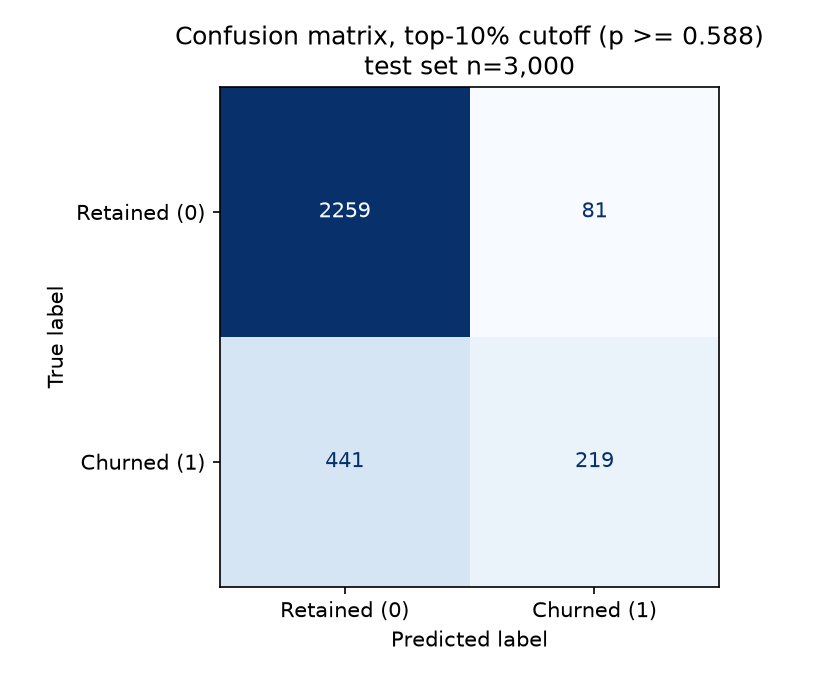
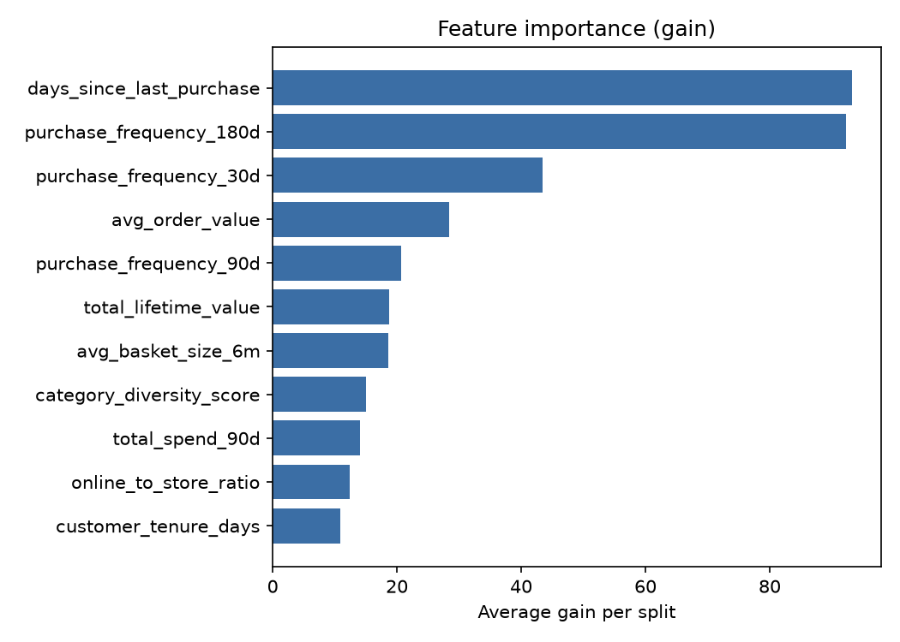

# Lab 3 — Churn Model Evaluation Report

All numbers are from the graded run **`xgb-d6-eta0.03-r600-final`**. They are the same numbers in
[`lab3-evidence/evaluation_metrics.json`](lab3-evidence/evaluation_metrics.json), MLflow run
`dfc0f14a9afc4213a4a6ea5351a7e87c` (experiment `northstar-churn`), and Model Registry version
**`northstar-churn-models/2`** (`PendingManualApproval`). The console output is in
[`lab3-evidence/train-final.log`](lab3-evidence/train-final.log).

## Results

Test set: 3,000 customers (660 churners, 22.0%).

| Metric | Value | Threshold | Result |
|---|---|---|---|
| AUC-ROC (test set) | **0.7857** | report only, no fixed threshold | — |
| Precision @ top 10% | **0.7300** | ≥ 0.50 | Pass |
| Recall @ top 10% | **0.3318** | ≥ 0.25 | Pass |
| AUC lift over recency-only baseline | **+0.0631**, 95% CI **[0.0441, 0.0824]** | 95% CI must exclude zero | Pass |

Precision of 0.73 means the 300 highest-risk customers churn at 3.3× the 22% base rate. Recall has a ceiling: a
10% contact budget is 300 customers, and there are 660 churners, so recall cannot exceed 300 / 660 ≈ 0.45. The model's
0.3318 captures about 74% of what that budget can reach.

## Baseline comparison

| Model | Test AUC |
|---|---|
| Recency-only baseline (`days_since_last_purchase` alone) | 0.7226 |
| Full model (11 features) | 0.7857 |
| **Lift** | **+0.0631**, 95% CI **[0.0441, 0.0824]** |

**Method.** The baseline is an XGBoost model trained on `days_since_last_purchase` alone, on the same training rows as
the full model and scored on the same test rows. It stands in for the rule the business already has for free: contact
whoever hasn't bought lately. The confidence interval comes from a **paired bootstrap** of the test set. Over 2,000
replicates (seed 42), the 3,000 test rows are resampled with replacement, both models are scored on the *same* resample,
and the difference in AUC is recorded. The interval is the 2.5th to 97.5th percentile of those differences. Pairing keeps
the correlation between the two models' scores, which resampling them independently would lose, inflating the interval.

**Reading.** The interval sits well above zero, so the Lab 2 features do measurable work beyond recency. The lift
closes about 23% of the gap between the baseline and a perfect ranker (0.0631 / (1 − 0.7226)). The result doesn't
depend on tuning: every configuration in the MLflow experiment (below) also had a lift CI that excluded zero.

## Confusion matrix

The threshold is the **top-10% cutoff (predicted probability ≥ 0.588)**, the same one the precision and recall gates
use. That's the decision the retention team would actually make (contact the 10% highest-risk customers), rather than
XGBoost's default of 0.5.

| | Predicted retained | Predicted churn (contacted) |
|---|---|---|
| **Actually retained** | 2,259 | 81 |
| **Actually churned** | 441 | 219 |

Exactly 300 customers were flagged (219 + 81), with no ties at the cutoff. Most of the 441 missed churners are
unavoidable at this budget, because a 300-person list can't hold 660 churners.

## Feature importance

Importance is measured by **gain**, the average loss reduction a feature's splits deliver. The default split count
over-credits continuous features that are split often for small improvements.

| Rank | Feature | Gain |
|---|---|---|
| 1 | days_since_last_purchase | 93.2 |
| 2 | purchase_frequency_180d | 92.3 |
| 3 | purchase_frequency_30d | 43.4 |
| 4 | avg_order_value | 28.3 |
| 5 | purchase_frequency_90d | 20.7 |
| 6 | total_lifetime_value | 18.8 |
| 7 | avg_basket_size_6m | 18.5 |
| 8 | category_diversity_score | 15.0 |
| 9 | total_spend_90d | 14.1 |
| 10 | online_to_store_ratio | 12.5 |
| 11 | customer_tenure_days | 10.9 |

Recency is still the strongest single feature, but 180-day purchase frequency is almost as strong. The frequency
features are the most likely source of the lift over the baseline. The behavioral features built to catch churners
who still look active (category diversity, channel mix, basket size) carry comparatively little gain. The design
document discusses this. Because the three frequency windows overlap, gain is split between correlated features, so a
low score is not by itself proof that a feature carries no signal. The ranking was identical in the default-parameter
run.

## Slice evaluation by loyalty tier

From [`lab3-evidence/slice-evaluation.csv`](lab3-evidence/slice-evaluation.csv). Aggregate recall@10% = 0.3318.

| Tier | Test n | Churners | AUC | Recall@10% | Recall SE | Too small to conclude? | Recall > 10 pp below aggregate? |
|---|---|---|---|---|---|---|---|
| Bronze | 1,071 | 361 | 0.7553 | 0.4377 | 0.026 | No | No |
| Gold | 483 | 52 | 0.7460 | 0.1346 | 0.047 | No | Yes |
| Platinum | 307 | 21 | 0.8820 | 0.0952 | 0.064 | **Yes** | Yes |
| Silver | 1,139 | 226 | **0.7281** | 0.2301 | 0.028 | No | Yes |

**How the columns are computed.** Recall for each tier uses the **same** top-10% cutoff as the aggregate metric,
because the retention team contacts one list across all customers, not the top 10% of each tier. Recall SE is the
binomial standard error, √(r(1 − r) / churners). A tier is **too small** when it has fewer than **30 churners**
(`--min-slice-positives`). Both AUC and recall are computed over the churners, so their noise depends on the number of
positives, not on n. At 30 churners, the recall standard error is about 0.08, roughly the size of the 10-point gap being
flagged.

**Weakest tier: Silver.** Silver has the lowest AUC (0.7281). With 1,139 customers and 226 churners, this is a
well-supported result, not noise. Silver was also the weakest tier in every one of the six MLflow runs (AUC 0.706–0.728),
so it isn't an artifact of one configuration. Its recall (0.2301) is also flagged as more than 10 points below the
aggregate, though only barely (the threshold is 0.2318).

**Low recall outside Bronze is mostly a ranking effect, not poor discrimination.** Gold and Silver have reasonable
within-tier AUCs (0.75 and 0.73) but low recall, because the shared contact list is dominated by Bronze customers,
whose recall is 0.44. A "contact the top 10% overall" policy reaches mostly low-spend customers. If the business values
retaining higher-tier customers more, a value-weighted ranking or per-tier budgets would serve it better than the
current single cutoff.

**Platinum is too small to conclude from.** Platinum has 307 test customers but only **21 churners**. Its AUC of 0.88 is
the highest of any tier, which is consistent with the lab's observation that Platinum is the model's strongest slice at
this dataset size. Its recall of 0.0952 (2 of 21 churners) has a standard error of ±0.06. Neither number supports a
firm claim in either direction, and we make none.

## Experiment runs

Every run used the Athena feature pull, XGBoost 3.4.1, the same split, `scale_pos_weight` 3.545, `min_child_weight` 5
and `subsample`/`colsample_bytree` 0.8. The baseline AUC is 0.7226 in every run.

| MLflow run | max_depth | eta | Best round | AUC | Lift [95% CI] | P@10% | R@10% |
|---|---|---|---|---|---|---|---|
| xgb-d6-eta0.1 | 6 | 0.1 | 10 | 0.7806 | +0.0580 [0.0383, 0.0774] | 0.7033 | 0.3197 |
| xgb-d3-eta0.1 | 3 | 0.1 | 36 | 0.7785 | +0.0559 [0.0372, 0.0747] | 0.7233 | 0.3288 |
| xgb-d6-eta0.03-r600 | 6 | 0.03 | 16 | 0.7857 | +0.0631 [0.0441, 0.0824] | 0.7300 | 0.3318 |
| xgb-d3-eta0.03-r600 | 3 | 0.03 | 3 | 0.7735 | +0.0509 [0.0307, 0.0719] | 0.6566* | 0.3621* |
| xgb-d6-eta0.03-r600-regtest | 6 | 0.03 | 16 | 0.7857 | +0.0631 [0.0441, 0.0824] | 0.7300 | 0.3318 |
| **xgb-d6-eta0.03-r600-final** | 6 | 0.03 | 16 | **0.7857** | **+0.0631 [0.0441, 0.0824]** | **0.7300** | **0.3318** |

- With the defaults (depth 6, eta 0.1), the model peaked at round 10, so the experiment varied tree depth and learning
  rate. Slower learning at depth 6 was best on AUC, lift and precision, and it was chosen for the graded run.
- The spread across configurations (AUC 0.7735–0.7857) is small next to the lift over the baseline. Feature engineering
  mattered much more than hyperparameters.
- \* The depth-3 / eta-0.03 model stopped at round 3 and produced only a few distinct scores. Ties at the 90th-percentile
  cutoff flagged 364 customers (12.1%) instead of 300, so its precision and recall are not true top-10% figures and
  aren't comparable with the other rows.
- The `-regtest` run (which tested Model Registry registration, version 1) and the graded run reproduce the
  `xgb-d6-eta0.03-r600` run exactly. The pipeline is deterministic end to end, because the Athena query orders rows by
  `customer_id` and all seeds are fixed.

## Provenance

| Item | Value |
|---|---|
| Training data | SageMaker Feature Store offline store `northstar-dev-customer-features`, queried through Athena (table `sagemaker_featurestore.northstar_dev_customer_features_1792273222`). Athena `QueryExecutionId` **1b890a7e-025f-47c7-a03a-37716caec411** |
| Rows | 9,999 customers (latest record per customer, deleted records excluded), 22.0% churn |
| Split | Stratified 70/30, `random_state=42`: 6,999 train / 3,000 test |
| Inputs | 11 features. Excluded: `churn_label` (target), `customer_id` (identifier), `loyalty_tier` (slice column only) and `churn_risk_score` (a pure recency heuristic; leaving it out makes the baseline comparison clean, so no with/without comparison is needed) |
| Missing values | None in this data. The pipeline leaves any missing values as NaN for XGBoost's native handling |
| Class imbalance | `scale_pos_weight` = negatives / positives in the training split = 3.545 (computed, not hardcoded) |
| Hyperparameters | max_depth 6, eta 0.03, num_round 600 (early stopping on validation AUC, patience 20, best round 16), min_child_weight 5, subsample 0.8, colsample_bytree 0.8, seed 42 |
| Library | **XGBoost 3.4.1**, trained locally |
| Tracking | MLflow App `northstar-mlflow`, experiment `northstar-churn`, run `dfc0f14a9afc4213a4a6ea5351a7e87c` |
| Registry | `northstar-churn-models` version 2, `PendingManualApproval`; artifact under `s3://northstar-dev-data-493155413162/artifacts/models/churn/` |

**Comparison with the lab reference.** The lab's reference run (XGBoost 3.2.0, default-style parameters) measured AUC
0.7696, baseline 0.7233, lift +0.0464 with CI [0.0254, 0.0670], precision 0.6833 and recall 0.3106. My baseline matches
the reference closely (0.7226 vs 0.7233). The full model is higher, which comes from the hyperparameter choice (my
default-parameter run scored 0.7806) and the different XGBoost version. The lab notes that metrics move between XGBoost
versions on identical data, so these are not expected to agree to four decimal places.
